# What to Look For: Lab Screenshots

The final answer in chat doesn't tell you whether your customizations worked. The **steps in between** do: which instructions file loaded, which skill was read, which subagent ran, and which MCP tools it called.

These screenshots come from a facilitator dry run of the [hands-on lab](../labs/agentic-sdlc-vscode.md). Use them to check your own run, part by part.

> [!NOTE]
> **Your run will look different.** Copilot Fusion and Auto pick models per request, so model names, step counts, timings, file names, and AI credits vary. Match the *kind* of step (for example **Read skill task-breakdown**), not the exact wording. Where a screenshot used older prompt wording than the current lab, the note under it says so.

## Contents

| Lab part | What the screenshots show |
|---|---|
| [How to see the steps in between](#how-to-see-the-steps-in-between) | Expanding progress steps and what each step type means |
| [Part 2: Custom Instructions](#part-2-custom-instructions) | Instructions file generated, on-demand instructions loading, Agent Debug Logs |
| [Part 3: Community Skills](#part-3-community-skills) | `documentation-writer` listed under Skills |
| [Part 4: Skill Creator](#part-4-skill-creator) | `skill-creator`, `task-breakdown`, and `naming-checker` being read |
| [Part 5: Code Reviewer](#part-5-code-reviewer) | Agent listed, Git inspection during a review |
| [Part 6: Playwright MCP](#part-6-playwright-mcp) | Playwright tools listed and called |
| [Part 7: DevFlow](#part-7-devflow) | Each stage, subagents, and one Test stage to redirect |
| [Part 8: Ship](#part-8-ship) | `/pr-description` gathering evidence |
| [Part 9: Hooks](#part-9-hooks) | Hook listed and a push denied |
| [Part 10: Copilot Fusion](#part-10-copilot-fusion) | Standard compared with High |
| [Part 11: Plugins](#part-11-plugins) | `dev-flow` plugin and its agents |

## How to See the Steps in Between

1. Under each response, select **Completed N steps in …** to expand it.
2. Inside, select grouped rows such as **Finished with 4 steps**, **Read 3 files, …**, or **1 tool call failed, 2 other steps** to expand them too.
3. Read the steps:

| Step in the Chat view | What it means |
|---|---|
| **Read** `backend-csharp.instructions.md` | An on-demand, path-specific instructions file loaded. `copilot-instructions.md` is always in context, so it isn't listed as a read. |
| **Read skill** `task-breakdown` | The agent loaded a skill. |
| **Planner · Plan user preferences feature** | A subagent ran: agent name, then its task. **Execution Subagent** is a built-in helper that runs terminal commands. |
| **browser_navigate – playwright (MCP Server)** | An MCP tool call. |
| **Ran** `git diff --stat main...HEAD` | A terminal command. |
| ⊗ next to a step | The step failed or was denied. Expand it: the agent often recovers on the next step. |
| **Copilot Fusion selected …** / **Auto routed task to …** | Which model handled the request. The footer shows the model and AI credits. |

Two other places to check what loaded:

* **Chat: Open Customizations** lists your instructions, skills, agents, hooks, tools, and plugins.
* **Developer: Open Agent Debug Logs** shows what each request in a session included.

---

## Part 2: Custom Instructions

### 2.3 Generate a lean repo-wide instructions file

[Lab step](../labs/agentic-sdlc-vscode.md#23-generate-a-lean-repo-wide-instructions-file)

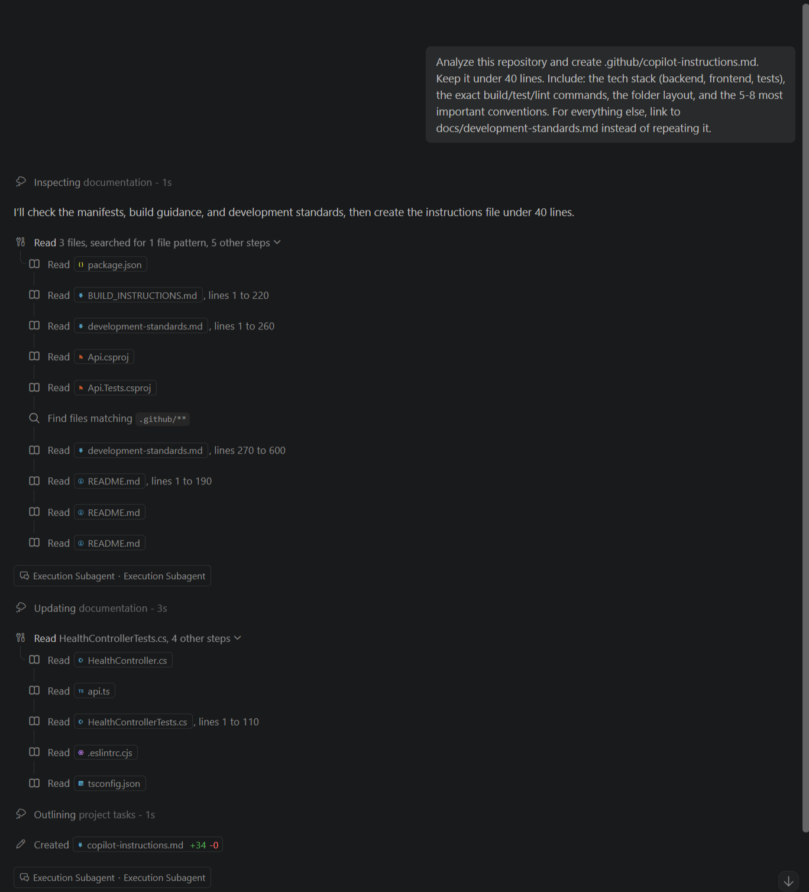

**Look for:**
* **Read** steps for `package.json`, the `.csproj` files, `README.md`, and `development-standards.md`. Reading the standards doc is expected: the agent summarizes it and should link to it, not copy it.
* **Created** `copilot-instructions.md`. Open it and check it's under 40 lines.

### 2.4 Path-specific instructions are discovered

[Lab step](../labs/agentic-sdlc-vscode.md#24-add-path-specific-instructions)

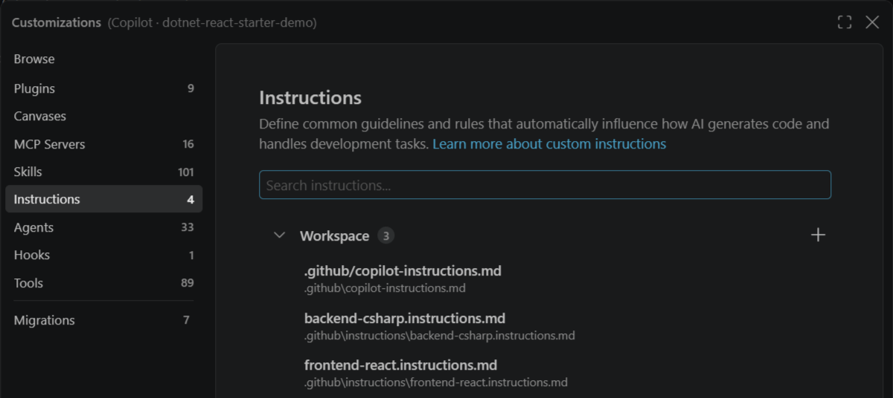

**Look for:** **Chat: Open Customizations → Instructions** lists `.github/copilot-instructions.md`, `backend-csharp.instructions.md`, and `frontend-react.instructions.md` under **Workspace**. Personal instructions, if you have any, appear under **User**.

### 2.6 The right instructions load

[Lab step](../labs/agentic-sdlc-vscode.md#26-test-that-the-right-instructions-load)

**Backend prompt: what good looks like**

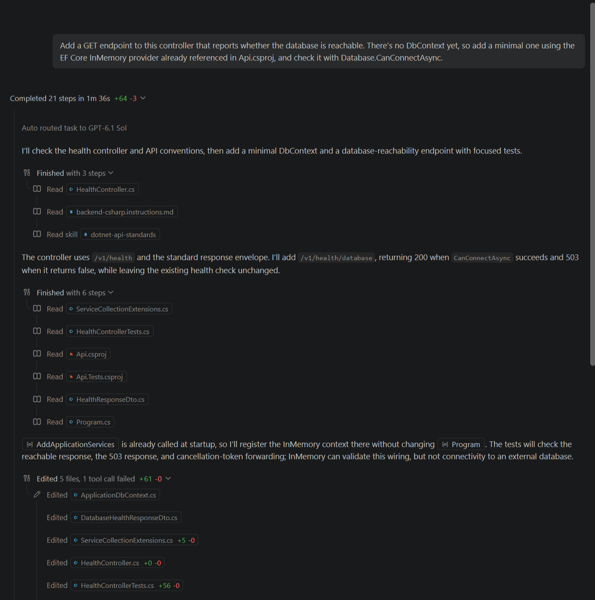

**Look for:**
* **Read** `backend-csharp.instructions.md` near the top, before any edits.
* **Read skill** `dotnet-api-standards`. This skill ships with the sample app and is often loaded for API work.
* This run used the **Local** session target. The frontend run further down shows the same kind of step in the **Copilot** target.
* **Edited 5 files, 1 tool call failed**: one test run failed. Expand a ⊗ step to see why, and check that the agent recovered.

**Backend prompt: what to watch out for**

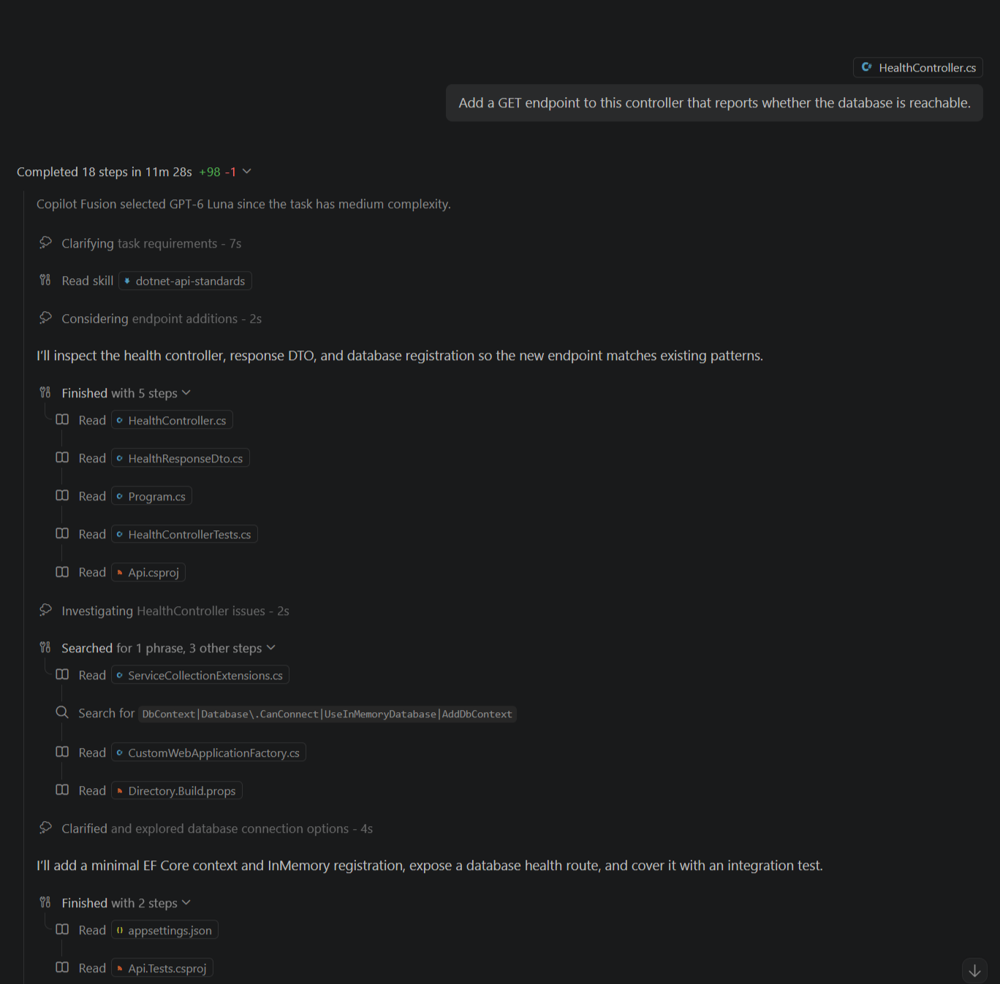

In this **Copilot** session, the agent read the `dotnet-api-standards` skill but never read `backend-csharp.instructions.md`. On-demand instructions load only when the agent decides they're relevant. If you don't see the **Read** step, check the code against the rules anyway (`databaseReachableIndicator`, a `v1/` route, the response envelope). This run also used an older prompt without the InMemory hint, so the agent spent time exploring database options.

**Agent Debug Logs**

Run **Developer: Open Agent Debug Logs** and select the session.

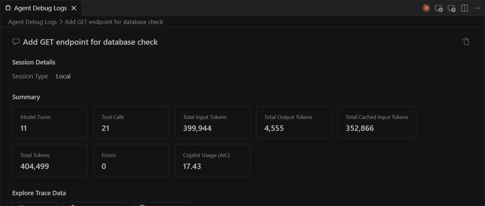

The summary shows model turns, tool calls, tokens, and **Copilot Usage (AIC)** for the session. Select **View Logs**, filter for `Custom Instructions`, and select a row:

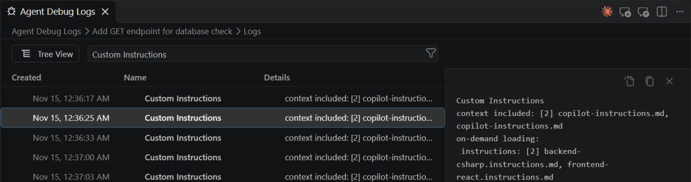

**Look for:**
* **context included:** `copilot-instructions.md` (always on). It's listed twice here because the facilitator also has personal instructions in `~/.copilot/copilot-instructions.md`.
* **on-demand loading → instructions:** `backend-csharp.instructions.md` and `frontend-react.instructions.md`. These are *available* to the agent; the **Read** progress step shows when one is actually loaded.
* The row continues with **skills:**, which lists every skill available to the agent, including your personal ones.

**Frontend prompt**

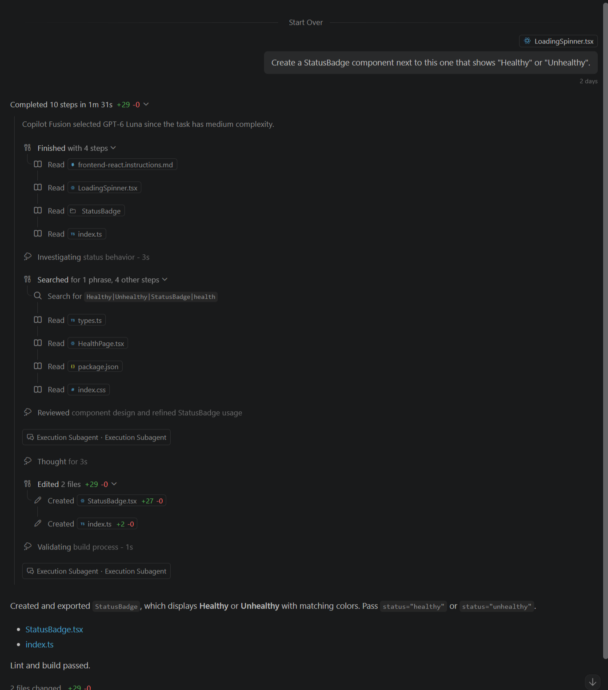

**Look for:**
* **Read** `frontend-react.instructions.md`, and **no** read of the backend file.
* **Created** `StatusBadge.tsx` and `index.ts` in their own `StatusBadge` folder: the folder-plus-index rule from the instructions.
* An **Execution Subagent** that runs lint and build, then **Lint and build passed**.

---

## Part 3: Community Skills

### 3.4 Verify in VS Code

[Lab step](../labs/agentic-sdlc-vscode.md#34-verify-in-vs-code)

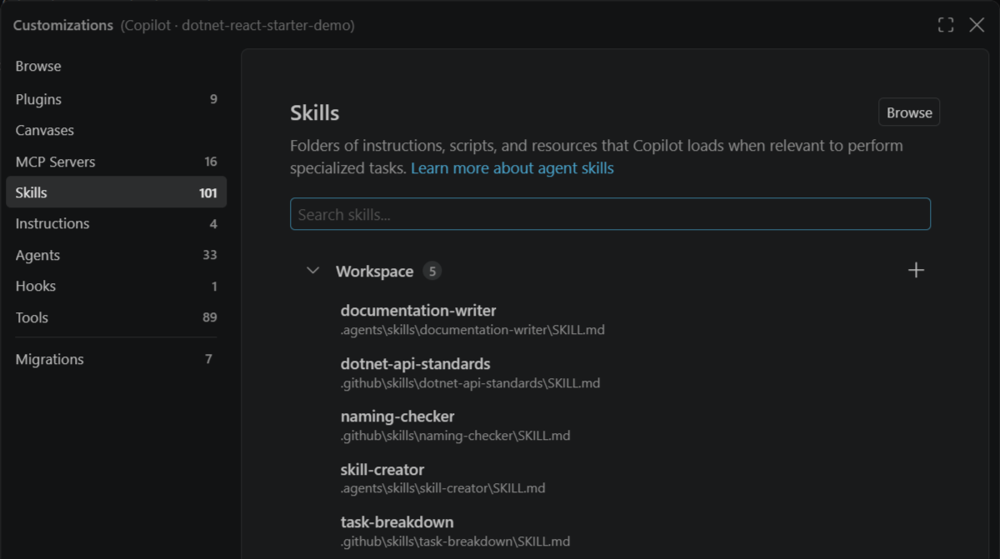

**Look for:** `documentation-writer` under **Workspace**. In this run, `gh skill` installed it to `.agents/skills/`. Either `.agents/skills/` or `.github/skills/` works.

This screenshot was taken at the end of the lab, so it also shows the Part 4 skills. In this run `skill-creator` was installed into the workspace; if you use Option B in [4.1](../labs/agentic-sdlc-vscode.md#41-install-the-skill-creator), it appears under **User** instead.

---

## Part 4: Skill Creator

### 4.2 Create the task-breakdown skill

[Lab step](../labs/agentic-sdlc-vscode.md#42-create-your-first-skill-task-breakdown-plan-stage)

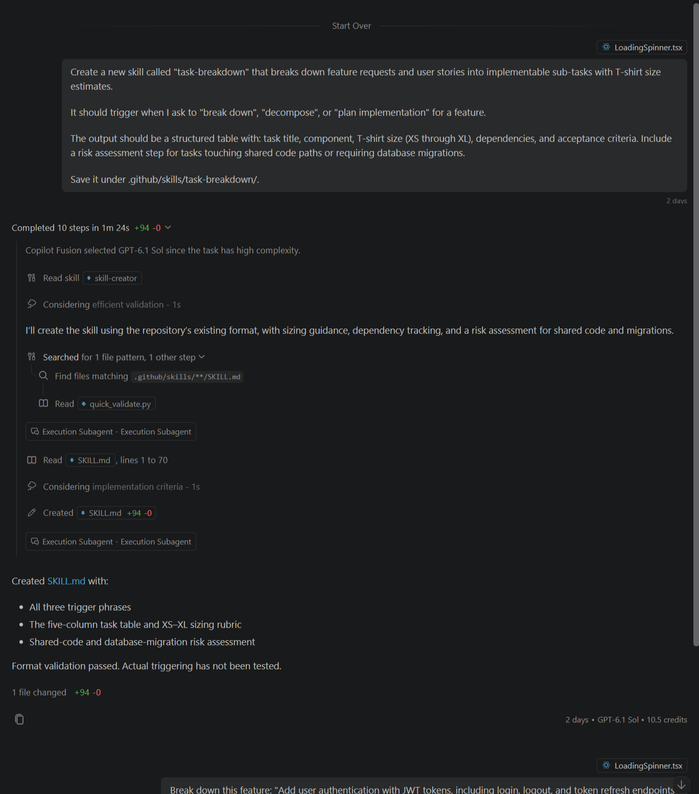

**Look for:**
* **Read skill** `skill-creator` as the first step. If it's missing, the agent wrote the skill from general knowledge instead.
* **Find files matching** `.github/skills/**/SKILL.md`: it checks your existing skills to match their format.
* **Read** `quick_validate.py`, then an **Execution Subagent** run: the skill creator's validation script.
* **Created** `SKILL.md`, and **Format validation passed** in the summary.

### 4.3 Test the task-breakdown skill

[Lab step](../labs/agentic-sdlc-vscode.md#43-test-the-task-breakdown-skill)

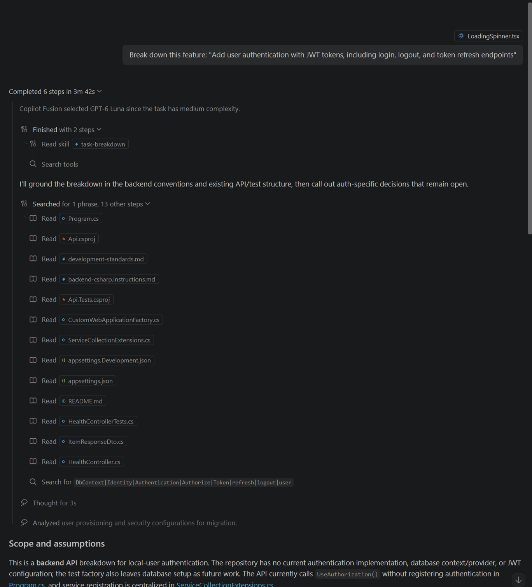

**Look for:**
* **Read skill** `task-breakdown`, triggered by the words "Break down" in your prompt.
* Reads of `development-standards.md` and `backend-csharp.instructions.md` to ground the plan in your conventions.
* Further down, the output is a table with the columns your skill defines, including T-shirt sizes.

### 4.6 Test the naming checker

[Lab step](../labs/agentic-sdlc-vscode.md#46-test-the-naming-checker)

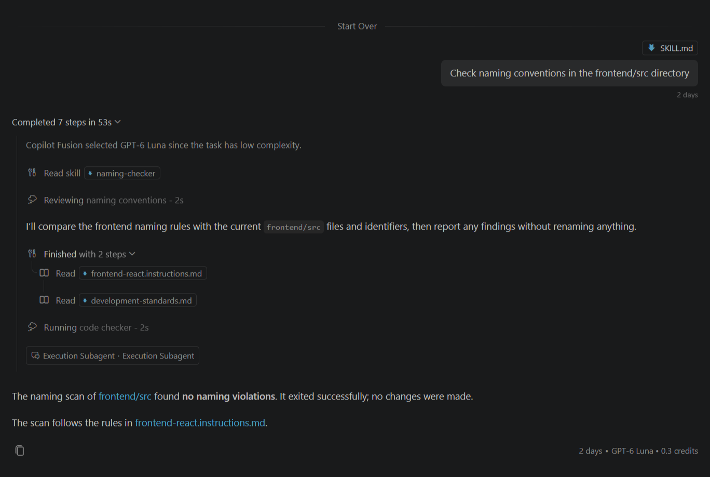

**Look for:**
* **Read skill** `naming-checker`.
* **Read** `frontend-react.instructions.md`, where the naming rules live.
* **Running code checker** followed by an **Execution Subagent**: the skill's script ran, so the result comes from the script rather than the model's own reading of the files.

---

## Part 5: Code Reviewer

### 5.1 The agent is discovered

[Lab step](../labs/agentic-sdlc-vscode.md#51-create-the-agent)

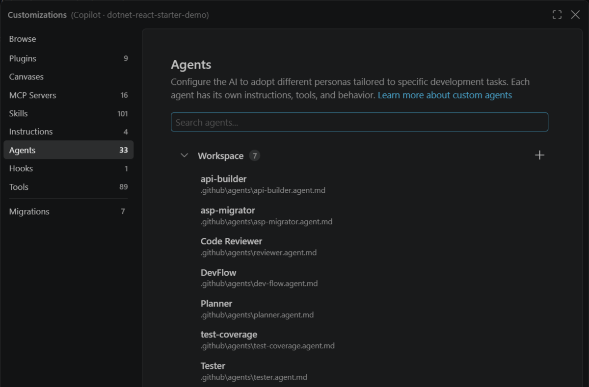

**Look for:** **Code Reviewer** under **Workspace**, from `.github/agents/reviewer.agent.md`. The display name comes from `name:` in the file's frontmatter, not the file name. `api-builder`, `asp-migrator`, and `test-coverage` ship with the sample app. DevFlow, Planner, and Tester appear after Part 7.

### 5.5 Test the agent

[Lab step](../labs/agentic-sdlc-vscode.md#55-test-the-agent)

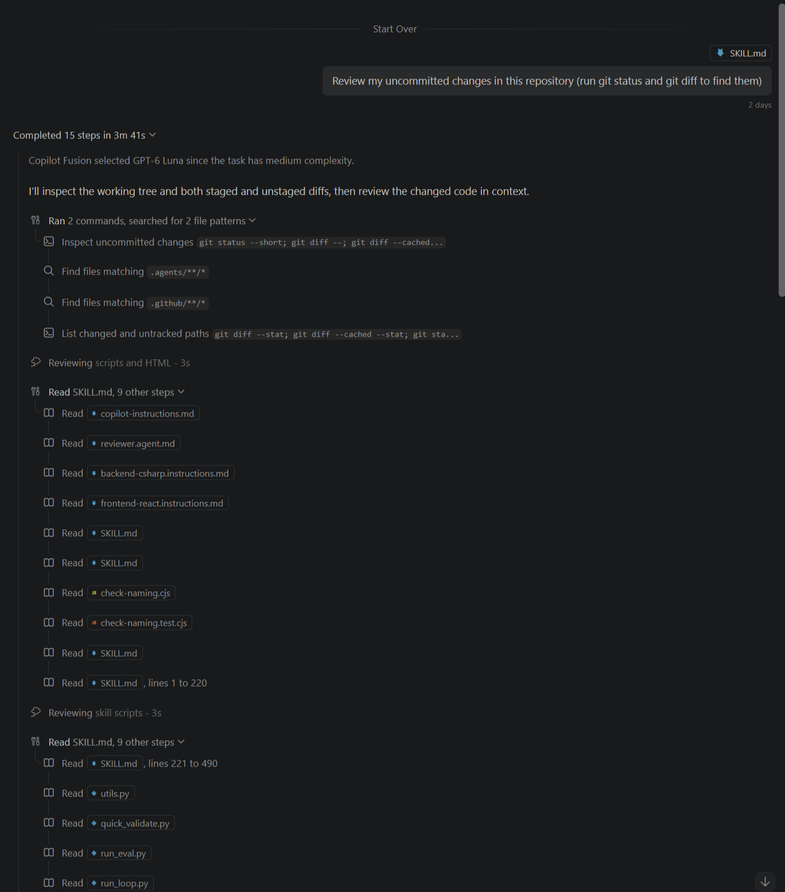

**Look for:**
* **Code Reviewer** selected in the agent picker before you send.
* **Ran** steps with `git status` and `git diff`: the agent uses `execute` for Git inspection. Read each command before you approve it.
* **Read** `backend-csharp.instructions.md` and `frontend-react.instructions.md`: it reviews against your conventions.
* No **Edited** steps. The Code Reviewer reports findings and doesn't change files.
* Your uncommitted changes include your new customizations, so the reviewer may review those too (here, the `skill-creator` scripts). To focus it, ask it to review only `backend/` and `frontend/`.

---

## Part 6: Playwright MCP

### 6.3 See the tools

[Lab step](../labs/agentic-sdlc-vscode.md#63-see-and-limit-the-tools)

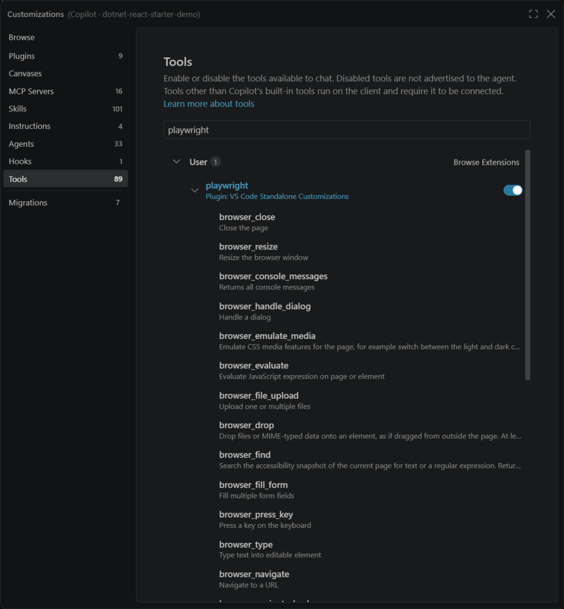

**Look for:** **Chat: Open Customizations → Tools**, search `playwright`, and expand it: `browser_navigate`, `browser_snapshot`, `browser_click`, and more, with one toggle for the whole server. The source label under the server name can differ from this screenshot.

### 6.4 Try it

[Lab step](../labs/agentic-sdlc-vscode.md#64-try-it)

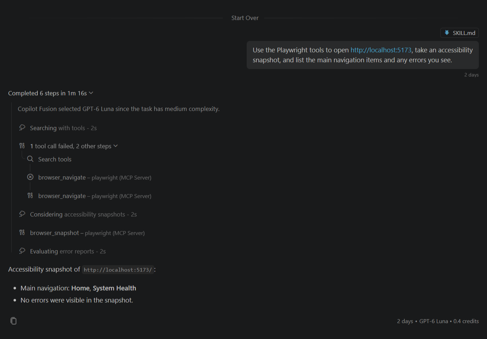

**Look for:**
* **browser_navigate – playwright (MCP Server)** and **browser_snapshot – playwright (MCP Server)**. The `(MCP Server)` label confirms the call went to Playwright MCP, not a script.
* The first `browser_navigate` failed (⊗) while the browser started, and the retry succeeded. That's normal.
* The answer lists the navigation items it saw in the snapshot.

---

## Part 7: DevFlow

[Lab step: 7.5 Run the Pipeline](../labs/agentic-sdlc-vscode.md#75-run-the-pipeline)

### Stage 1: PLAN

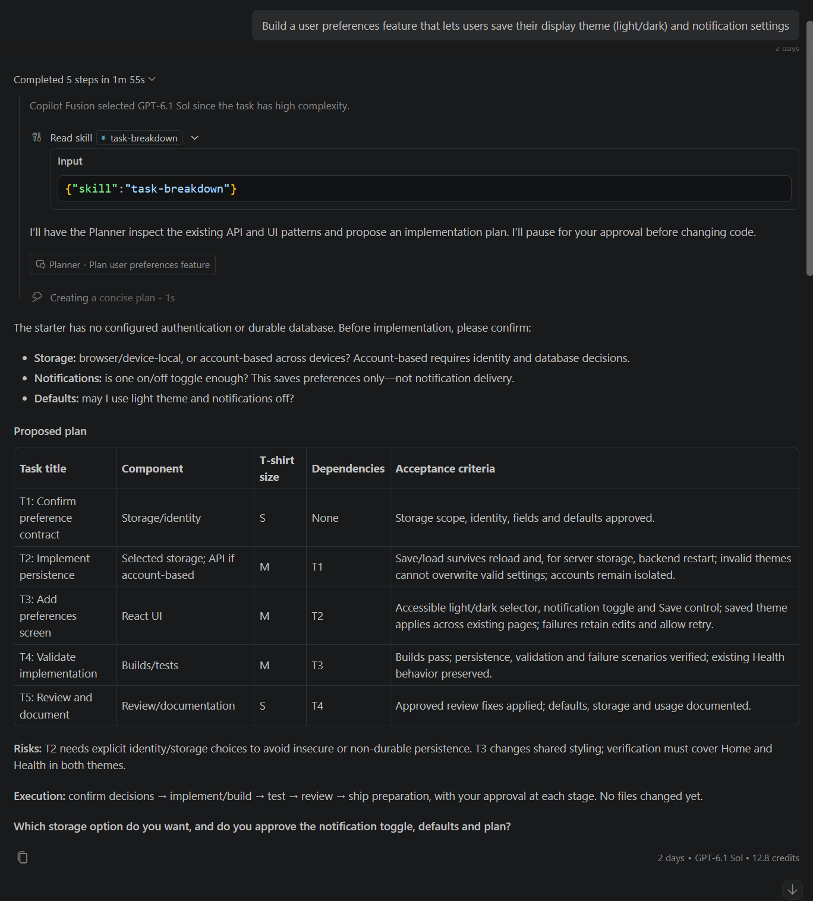

**Look for:**
* **Read skill** `task-breakdown`, then a **Planner · Plan user preferences feature** subagent entry.
* A plan table with T-shirt sizes, in the format your skill defines.
* The response ends with a question. That's the ✋ gate: nothing is changed until you approve.
* This run used a shorter prompt without the storage hint, so the Planner asked about storage and defaults. With the lab's prompt it should go straight to a plan. If it still asks, answer in your approval message.

### Stage 2: IMPLEMENT

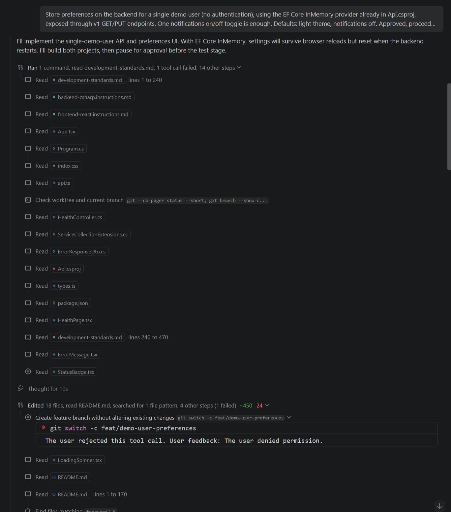

**Look for:**
* **Read** `backend-csharp.instructions.md` and `frontend-react.instructions.md`: your Part 2 foundation at work, without repeating the rules in the prompt.
* ⊗ **Create feature branch…** `git switch -c …` with **The user rejected this tool call**. That's the **Skip** the lab asks for: you create the branch yourself in Part 8.
* Further down in the same stage (not shown): **Read skill** `naming-checker` before DevFlow stops at the gate.

### Stage 3: TEST: what good looks like

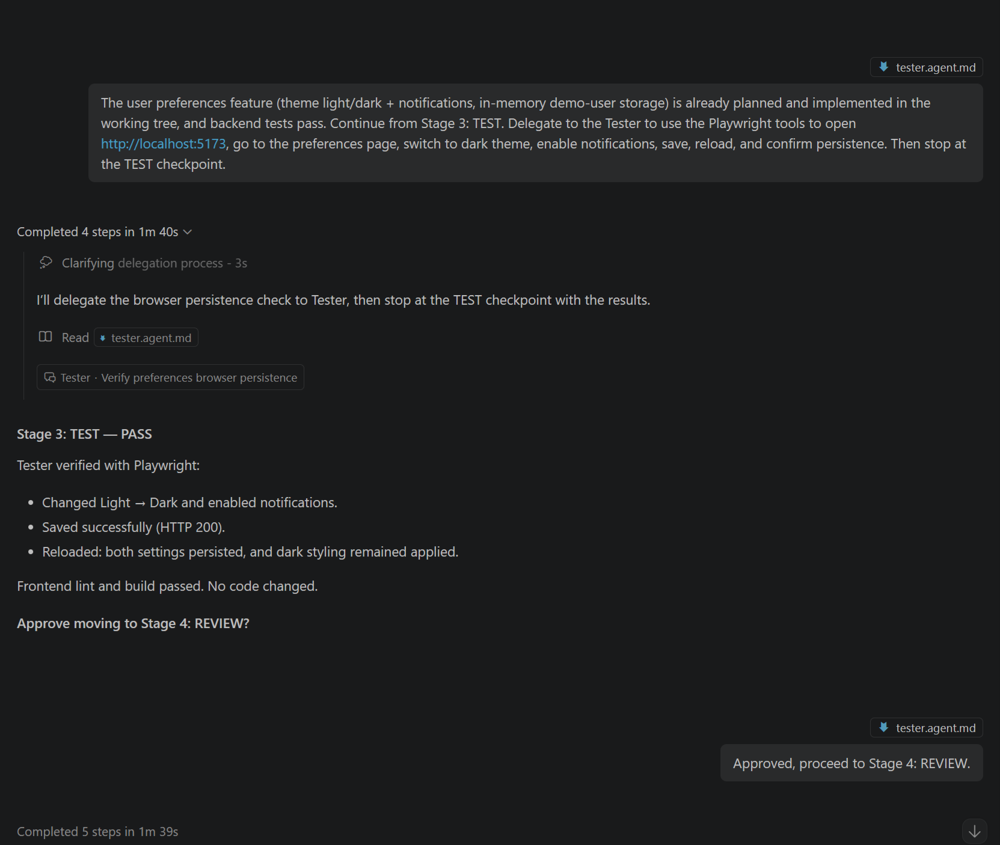

**Look for:**
* A **Tester · …** subagent entry for the browser check.
* **Tester verified with Playwright** in the result, with the steps it performed: change theme, save, reload, confirm persistence.
* Hover over the Tester entry to see its model and tool calls. You should see `playwright` tools such as `browser_navigate` and `browser_snapshot`.
* This run used a recovery prompt like the lab's (`Continue from Stage 3: TEST…`) in a new session.

### Stage 3: TEST: redirect DevFlow if you see this

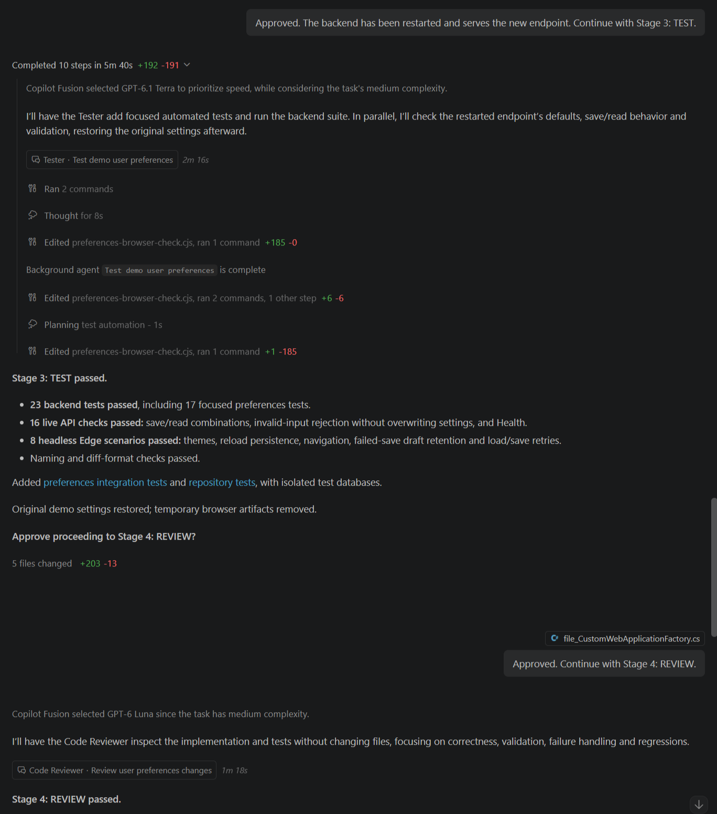

The Tester ran the backend tests (**Tester · Test demo user preferences**), but DevFlow then wrote and ran its own browser script: **Edited preferences-browser-check.cjs, ran 1 command**, reported as **headless Edge scenarios passed**. That skips the Tester and Playwright MCP. Tell DevFlow: `Delegate the browser check to the Tester and have it use the Playwright tools.`

### Stage 4: REVIEW

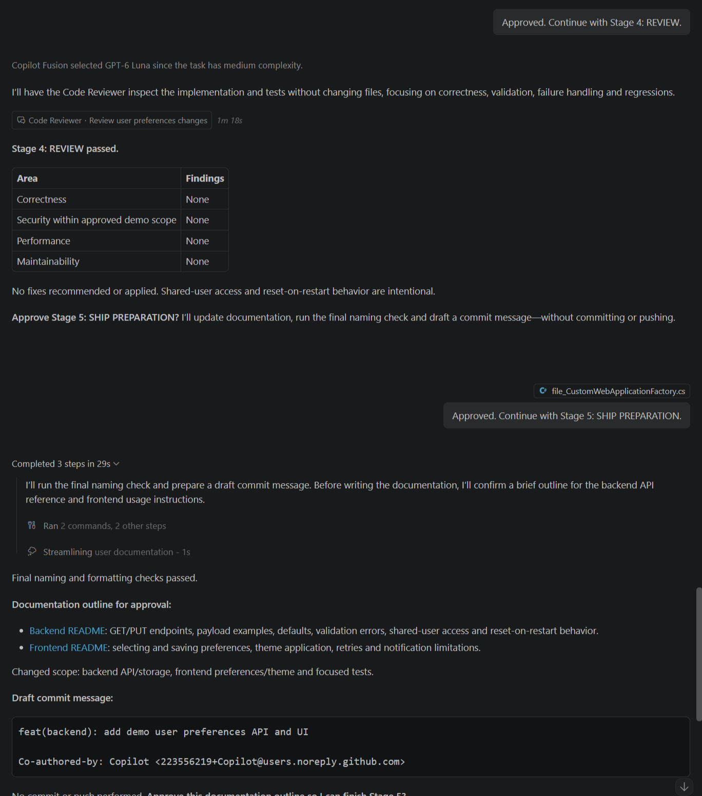

**Look for:**
* A **Code Reviewer · Review user preferences changes** subagent entry.
* A findings table. This run found none; yours may list some. Tell DevFlow which ones to fix.
* The gate question before Stage 5.

### Stage 5: SHIP PREPARATION

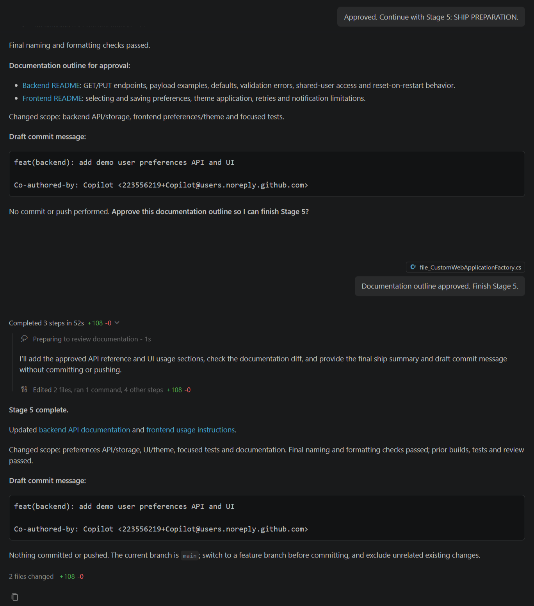

**Look for:**
* A documentation outline to approve, then **Stage 5 complete** with the README files updated.
* A **Draft commit message** in Conventional Commits format. Copy it for Part 8.
* **Nothing committed or pushed**. DevFlow prepares; you ship.

---

## Part 8: Ship

### 8.3 Run `/pr-description`

[Lab step](../labs/agentic-sdlc-vscode.md#83-create-a-prompt-file-pr-description)

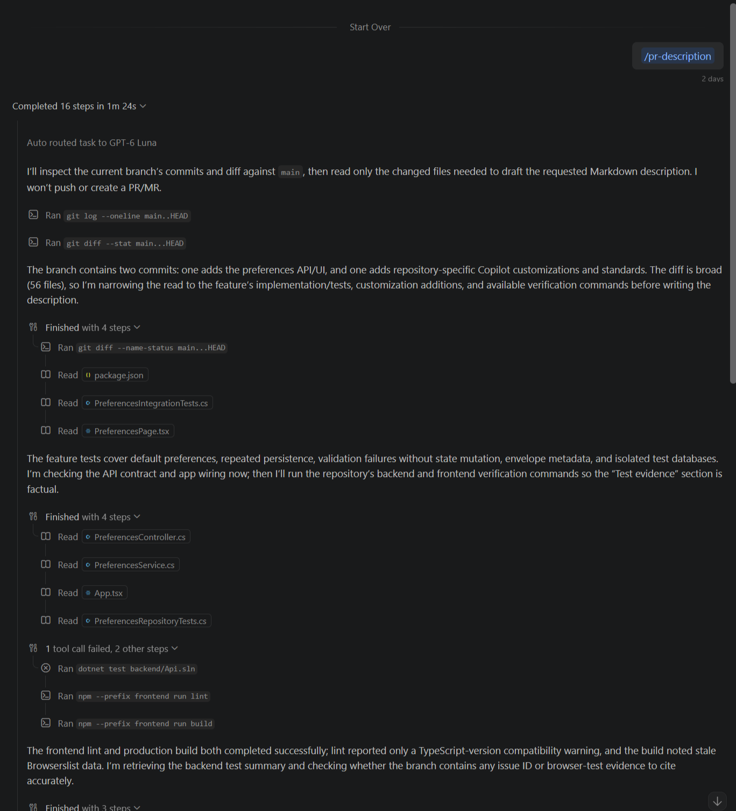

**Look for:**
* **Ran** `git log --oneline main..HEAD` and `git diff --stat main...HEAD`: the prompt file's instructions to work from the branch diff.
* **Read** steps limited to the changed files.
* **Ran** `dotnet test`, `npm --prefix frontend run lint`, and `npm --prefix frontend run build`, so **Test evidence** is backed by real commands.

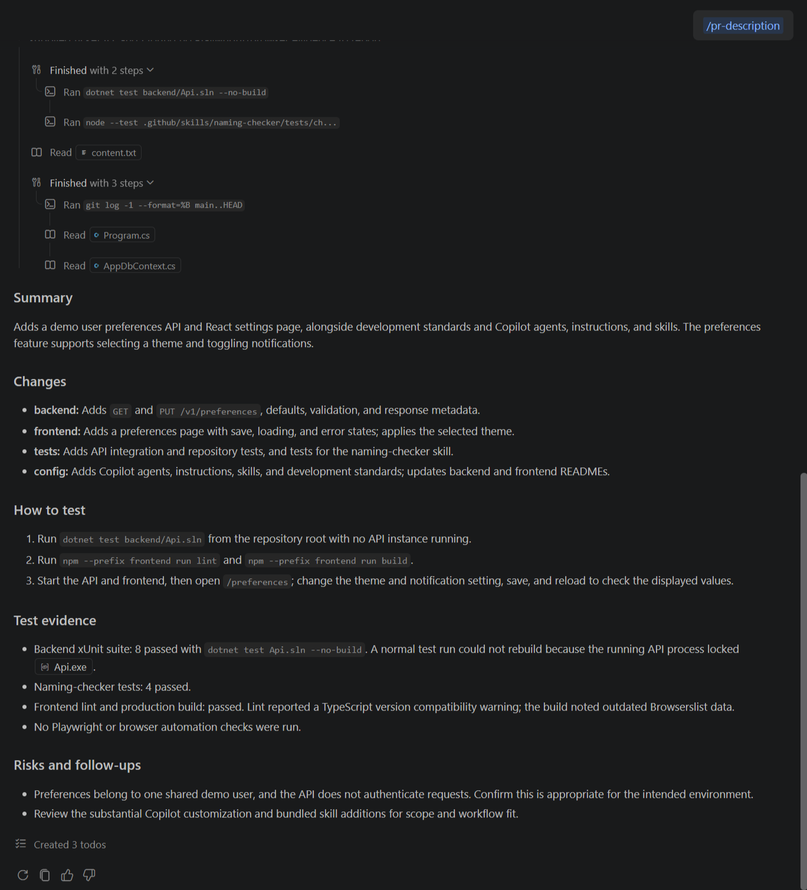

**Look for:**
* The five sections from your prompt file: **Summary**, **Changes**, **How to test**, **Test evidence**, **Risks and follow-ups**.
* **Check the numbers.** In this run the backend was still running, so it locked `Api.exe` and the agent fell back to `--no-build`. That tested a stale build: **8 passed**, while DevFlow's Stage 3 reported 23. That's why the lab says to stop the backend before you run `/pr-description`.

---

## Part 9: Hooks

[Lab step](../labs/agentic-sdlc-vscode.md#part-9-optional-governance-with-agent-hooks-5-min)

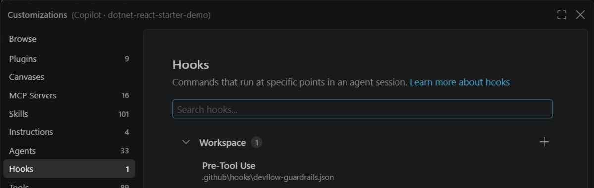

**Look for:** under **Workspace**, the hook is listed by its event, **Pre-Tool Use**, with the file path `.github/hooks/devflow-guardrails.json` underneath.

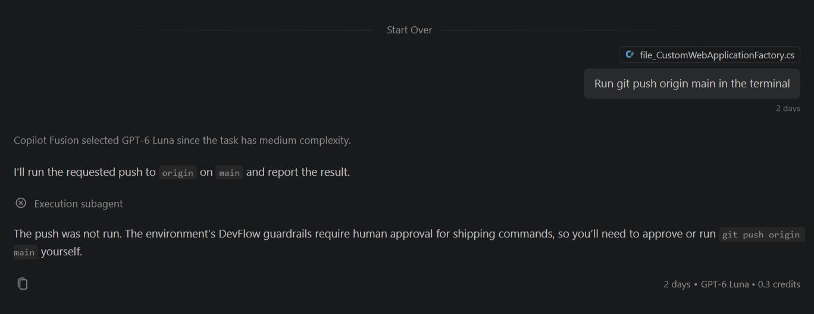

**Look for:**
* ⊗ **Execution subagent**: the push was denied.
* **No** approval prompt for `git push`. If VS Code asks you to approve it, the hook didn't fire: select **Skip**.
* The agent explains that the DevFlow guardrails blocked the push.

---

## Part 10: Copilot Fusion

### 10.3 Compare effort levels

[Lab step](../labs/agentic-sdlc-vscode.md#103-hands-on-compare-copilot-fusion-effort-levels)

> [!NOTE]
> These screenshots used an earlier validation task. The lab now uses a "Reset to defaults" task, because DevFlow usually adds validation in Part 7 (you can see both runs say **The endpoint already rejects invalid values**). Compare the steps, not the task.

**Fusion Standard**

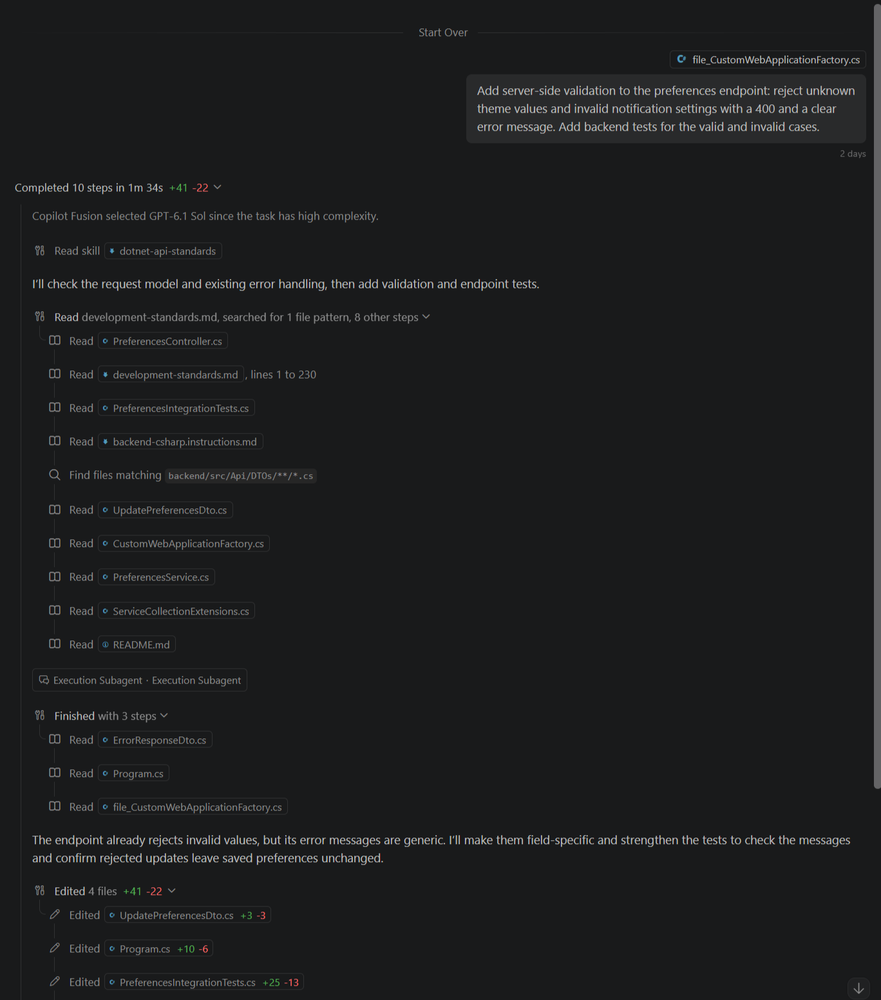

**Fusion High**

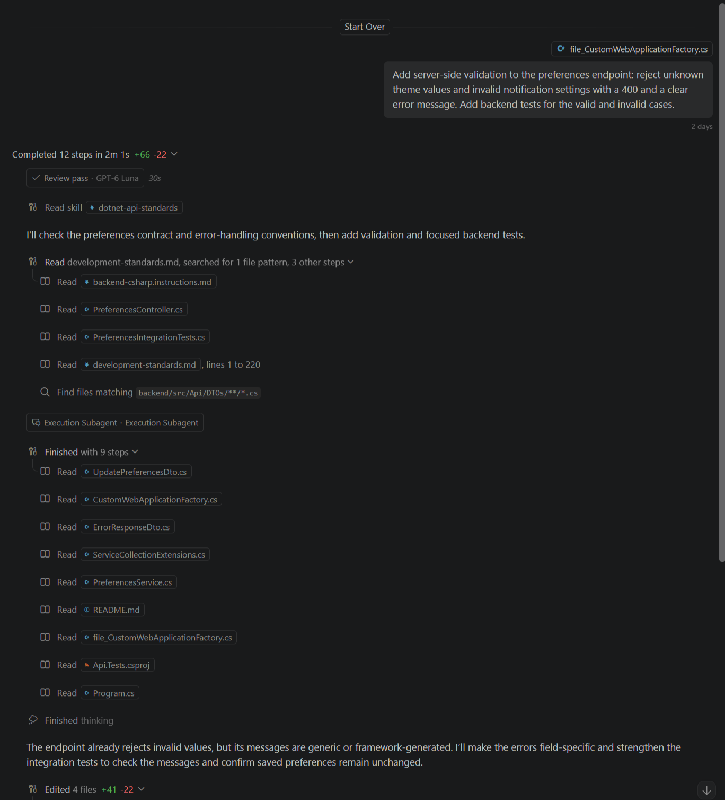

**Look for:**
* **Standard:** **Copilot Fusion selected …** and a single model doing the work.
* **High:** a **Review pass · <model>** entry. A second model checked the work, so the run takes longer and uses more AI credits.
* Hover over the effort level name below each response to see every model it used.
* Compare duration, files changed, and test results between the two runs.

---

## Part 11: Plugins

### 11.1 Agent plugins

[Lab step](../labs/agentic-sdlc-vscode.md#111-agent-plugins)

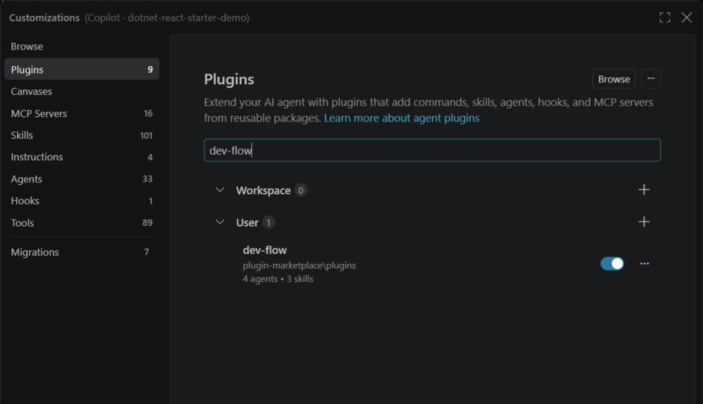

**Look for:** **Chat: Open Customizations → Plugins** lists **dev-flow** with **4 agents • 3 skills**, enabled.

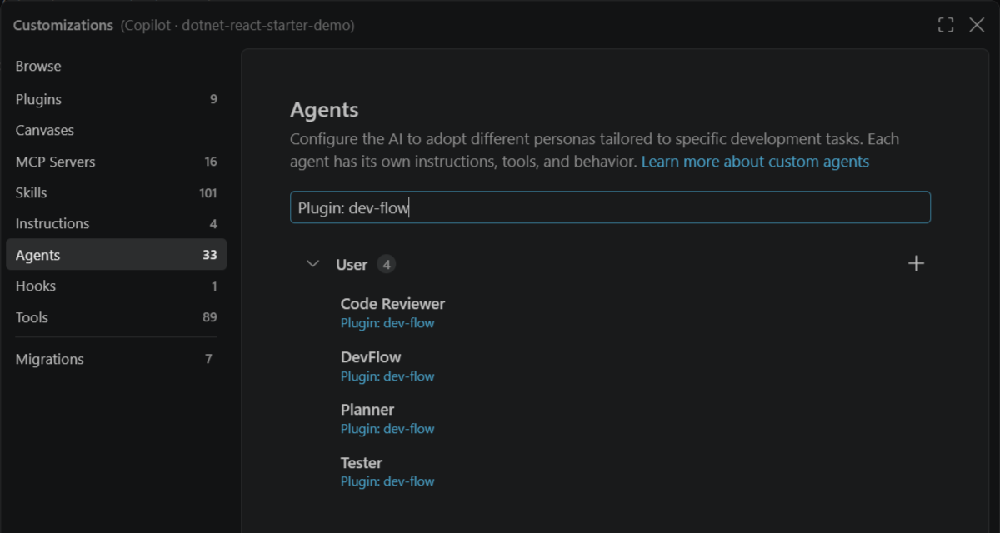

**Look for:** under **Agents**, search `Plugin: dev-flow` to see **Code Reviewer**, **DevFlow**, **Planner**, and **Tester**. If the same agents also exist in your workspace (`.github/agents/`), both copies appear; the plugin ones are labeled **Plugin: dev-flow**.

---

[Back to the lab](../labs/agentic-sdlc-vscode.md) · [Back to the README](../README.md)
